# Masterarbeit Ramon Füglister

**Einfluss von CBM auf metakognitive Kalibrierung, Lernleistung und Motivation**

Masterarbeit in Psychologie an der FernUni Schweiz, durchgeführt mit einer Klasse des ZAG Winterthur.

Die fertige Arbeit und eine kurze Präsentation der Ergebnisse finden Sie bis Ende Februar 2027 hier und auf der Projektseite: https://ramonfueglister.github.io/Masterarbeit_Ramon_Fueglister/

Vielen Dank allen Studierenden, die an der Studie teilgenommen haben.

Ramon Füglister, ZAG Winterthur
